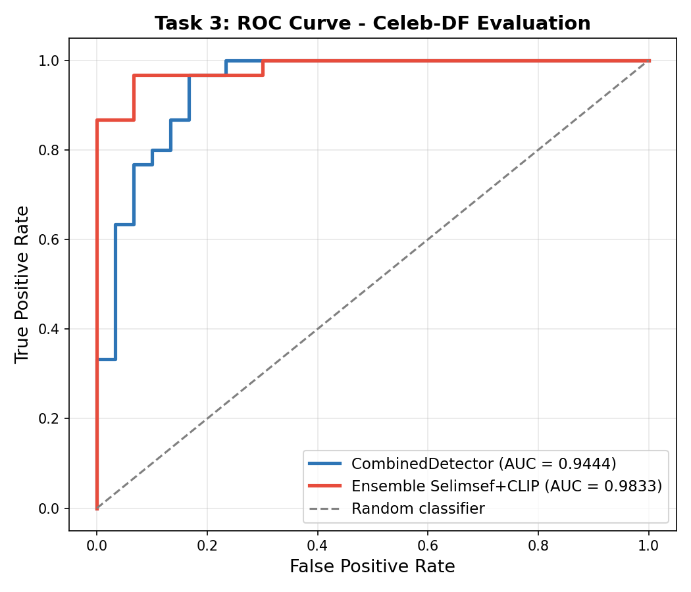

# DeepFakes Detection Lab

Cross-dataset deepfake detection system trained on FaceForensics++ and evaluated on Celeb-DF.

## Results

| System | Video-level AUC |
|--------|----------------|
| Task 2 baseline (UADFV → Celeb-DF) | 59.00% |
| CLIP ViT-B/16 + attention_did | 75.61% |
| GenD (ViT-L/14 + LN-tuning, 1 method) | 88.89% |
| Yermandy backbone + linear head | 92.44% |
| **CombinedDetector (ours)** | **94.44%** |
| Ensemble: Selimsef + CombinedDetector | 98.33% |

### ROC Curves



## System Architecture

The final system (**CombinedDetector**) combines three components:

1. **Frozen CLIP ViT-L/14 backbone** — pre-trained with LN-tuning on all 4 FF++ forgery methods (Yermandy et al., arXiv 2503.19683). Produces L2-normalised embeddings of dimension 1024.

2. **Trainable attention head (attention_did)** — Multi-Head Self-Attention (16 heads) + MLP with Dropout 0.5, trained on FF++ Deepfakes + Self-Blended Images (SBI).

3. **Optimised temporal aggregation** — combines per-frame scores as:
   ```
   video_score = 0.6 × weighted_avg + 0.3 × min_score + 0.1 × max_score
   ```

### Ensemble (additional experiment)

Combining CombinedDetector with the DFDC Kaggle winning solution ([selimsef](https://github.com/selimsef/dfdc_deepfake_challenge), 7× EfficientNet-B7) using weights 0.6/0.4 yields 98.33% AUC. Note: selimsef training data is not fully documented.

## Pipeline

```
Video frame (848×466)
    → MTCNN face detection (1.3x crop)
    → Resize 224×224 + CLIP normalisation
    → CLIP ViT-L/14 backbone (frozen) → [1024]
    → Multi-Head Self-Attention (16 heads)
    → MLP + Dropout 0.5 → logit
    → sigmoid → frame score [0,1]
    → Temporal aggregation (10 frames) → video score
    → Decision: score > 0.5 → real, score < 0.5 → fake
```

## Training

- **Dataset**: FaceForensics++ (Deepfakes method, 15,000 pairs) + SBI on-the-fly (50%)
- **Optimizer**: AdamW, cosine annealing, 20 epochs
- **Batch**: 16 × 4 accumulation steps = effective batch 64
- **Loss**: BCE + AUC margin loss (margin=0.3)

## Scripts

| Script | Description |
|--------|-------------|
| `scripts/final/model_combined.py` | CombinedDetector architecture |
| `scripts/final/train_combined.py` | Training with FF++ + SBI |
| `scripts/final/evaluate_combined.py` | Evaluation on Celeb-DF |
| `scripts/final/evaluate_ensemble.py` | Ensemble evaluation (requires selimsef) |
| `scripts/final/dataset_combined.py` | FF++ paired + SBI dataset |
| `scripts/experiments/model_gend.py` | GenD/LNCLIP-DF architecture |
| `scripts/experiments/evaluate_gend.py` | GenD evaluation |

## Requirements

```bash
pip install torch torchvision clip-by-openai facenet-pytorch scikit-learn tqdm matplotlib
```

## References

- Yermakov et al. "Unlocking the Hidden Potential of CLIP in Generalizable Deepfake Detection." arXiv:2503.19683, 2025.
- Shiohara & Yamasaki. "Detecting Deepfakes with Self-Blended Images." CVPR 2022.
- Rossler et al. "FaceForensics++." ICCV 2019.
- Li et al. "Celeb-DF." CVPR 2020.
- selimsef. DFDC Kaggle Challenge winning solution, 2020.